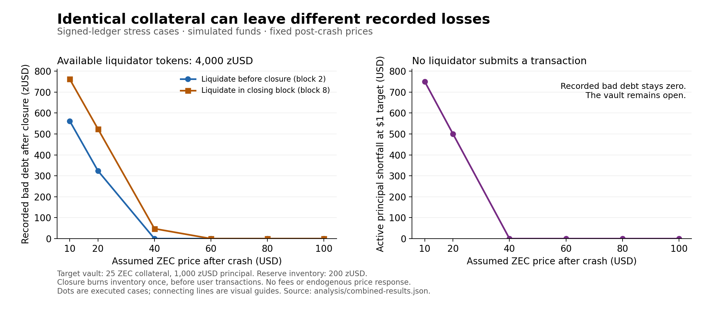

# Combined vault and reserve stress cases

The [Rust harness](../examples/combined_stress.rs) executes 351 deterministic cases through the signed vault and reserve ledger. It uses real model signatures, vault-issued tokens and the existing block validator. Every accepted block checks combined ZEC, token, principal and bad-debt conservation. Expected failed orders must return the specified error and leave the parent state unchanged. Unexpected errors stop the study.

The [JSON results](../analysis/combined-results.json) contain inputs, exact integer outcomes and final model checkpoints. These are assumed price paths and participation rules, not calibrated forecasts, success probabilities or proof of a dollar peg. No native Zcash funds or approved subsidy allocation are involved.



## Reproduce

```sh
cargo run --locked --example combined_stress
cargo run --locked --example combined_stress -- --check
cargo test --locked --example combined_stress
python3 analysis/check_combined.py
```

The first command emits the JSON; redirect it to `analysis/combined-results.json` to regenerate the artifact. `--check` requires an exact match with the checked-in file. Six example tests check selected economic boundaries independently of the golden output. Regenerate the optional figure with `python3 analysis/plot_combined.py`; that command additionally needs Matplotlib. Integer monetary units are zatoshi and micro-zUSD. Dollar marks are micro-USD, rounded down when needed; no consensus price is changed by a mark-to-market calculation.

## Liquidation, liquidity and closure timing

The 324 cases combine six true ZEC prices ($10, $20, $40, $60, $80, $100), three reporting delays (0, 2, 4 blocks), three liquidator token balances (0, 100, 4,000 zUSD), three initial reserve inventories (0, 200, 800 zUSD), and two liquidation times: when the report arrives or in the closing block.

At height 1 a borrower locks 25 ZEC, borrows 1,000 zUSD and sells the configured inventory to the reserve. A separate liquidator locks 1,000 ZEC and borrows 4,000 zUSD; that vault remains at least 250% collateralized throughout the grid. Tokens unavailable to the liquidator are transferred to a passive holder. They still exist and count toward supply. The liquidator does not borrow or buy more tokens during the scenario.

True ZEC price changes at height 2 and stays constant. The new signed price arrives at height 2, 4 or 6. Reserve closure is fixed at height 8. A liquidator with available tokens attempts the full-close action once at the assigned time. With no tokens, no order is submitted. At $80 and $100, an attempted liquidation is rejected because the vault is still at or above the 200% threshold. A rejected candidate is discarded; a block at the same height then accepts its price without that order.

For principal D, collateral C and the assumed true price P, the study keeps two shortfalls separate:

- Principal shortfall: `max(D - floor(C*P/1e8), 0)` in micro-USD.
- Bonus-adjusted liquidation shortfall: `max(D - floor(C*P*100/(1e8*105)), 0)` in micro-zUSD, treating each debt unit as its dollar target.

P is micro-USD per ZEC. The second expression includes the 5% collateral bonus. It is a capacity calculation, not proof that a liquidator will participate or receive a dollar for each token.

| True ZEC price | Target collateral value | Principal shortfall | Bad debt after a funded full liquidation, before reserve coverage |
|---|---:|---:|---:|
| $10 | $250 | $750 | 761.904762 zUSD |
| $20 | $500 | $500 | 523.809524 zUSD |
| $40 | $1,000 | $0 | 47.619048 zUSD |
| $60 | $1,500 | $0 | 0 zUSD |
| $80 | $2,000 | $0 | Liquidation rejected at exactly 200% |
| $100 | $2,500 | $0 | Liquidation rejected |

With only 100 tokens available, every eligible full liquidation in this grid fails for insufficient balance. At $10, that leaves **zero recorded bad debt and a live $750 principal shortfall**. Zero recorded bad debt is therefore not a solvency result. The ledger records the loss when liquidation closes the vault; it does not continuously write down principal at market prices.

Closure timing changes loss coverage. At $20 with 800 reserve tokens, liquidation before closure creates 523.809524 zUSD of bad debt and the terminal burn covers it entirely, leaving 276.190476 reserve tokens. If the same liquidation occurs in the closing block, closure first sees no bad debt and burns nothing. The subsequent liquidation creates 523.809524 bad debt while all 800 reserve tokens remain for auction. The burn is one-time; later blocks do not retroactively cover that debt.

Reporting delays often produce the same final monetary balances in this flat-price experiment. There are no intervening borrower trades or price movements to compound the delay. The JSON reports elapsed blocks between the true-price change and liquidation or the final height, making the longer unsettled exposure visible. The grid does not establish that real oracle delay has no cost.

## Re-signing stale market information

Six cases put the reserve into its normal inclusion-age pause, then have an authorized quorum re-sign the old $100/ZEC price at height 6. A higher sequence and fresh inclusion height resume trading. True ZEC price is assumed to be $20, $100 or $200. This is a valid signature path; the signed report has no market-observation timestamp.

For a 400-token order:

- When the reserve sells at the stale $100 price, it charges 4.02 ZEC. At a true $20/ZEC, that costs $80.40. The trader's conditional advantage is $319.60 **if** the tokens are worth one dollar each.
- When the reserve buys at the stale $100 price, it pays 3.98 ZEC. At a true $200/ZEC, that pays $796 for 400 tokens, a conditional $396 advantage at the same token-value assumption.

These are quote-value comparisons, not realized trading profits. At a true $20/ZEC the target vault is already underwater, so valuing its tokens at par is particularly uncertain. The results report that principal shortfall separately and do not count reserve inventory as recovered dollars.

## Funding limits and physical purchasing capacity

Twelve cases vary the retained-funding cap (10, 12 or 20 ZEC), the synthetic allocation (zero or 1 ZEC per block for ten blocks), and true-price marks ($20 or $100). Initial reserve cash is 10 ZEC, the cash target is 10 ZEC, and quoted ZEC price stays $100. The borrower issues 10,000 tokens against 250 ZEC and attempts nine 500-token sales, one per one-block epoch. Each accepted sale costs the reserve 4.975 ZEC. Closure occurs at height 10; inventory remains unsold.

With the 1-ZEC allocation enabled, every case receives 10 ZEC in scheduled funding. The outcomes are:

| Retained-funding cap | Initial cash plus retained credits | Accepted 500-token sales | Gross ZEC paid to trader | ZEC returned/diverted to NSM |
|---|---:|---:|---:|---:|
| 10 ZEC | 10 ZEC | 2 of 9 | 9.95 | 10.05 |
| 12 ZEC | 12 ZEC | 2 of 9 | 9.95 | 10.05 |
| 20 ZEC | 18 ZEC | 3 of 9 | 14.925 | 5.075 |

Initial cash fills the target before the first allocation, and closure precedes the last allocation, so those two credits go directly to NSM. A larger retained allowance need not finance another indivisible order. The 12-ZEC case retains two additional ZEC but still cannot pay for a third 500-token sale. Failed orders roll back tentative funding; the accepted replacement block credits the scheduled amount exactly once.

At a true $20/ZEC, a zatoshi purchases one fifth of its value at $100. The funded 12-ZEC case pays $199 of marked ZEC to the trader and ends with $201 of marked NSM cash. Those figures reconcile to the $400 current value of its 20-ZEC initial-plus-scheduled allocation. It also holds 1,000 tokens whose recovery value is unproven; the live vault's principal shortfall is $5,000. The accounting does not turn those tokens into dollar reserves.

## Auction participation and borrower incentives

Nine cases use the default 2,000-block descending auction, beginning at closure height 3. The reserve holds 400 tokens acquired from an actual 1,000-token vault issuance. True ZEC price is fixed at $20, $100 or $200. Three participation rules are compared:

1. No bidder submits an order. At the floor, all 400 tokens remain unsold and active principal is still 1,000 zUSD.
2. Only the borrower bids, at the floor. It buys all 400 tokens for 400 zatoshi, repays the entire 1,000-token loan and closes its vault. The remaining 600 tokens were retained from issuance.
3. A buyer valuing every token at one dollar buys at the first block whose quote is at or below that value. This is an assumed response rule, not a simulated competitive equilibrium.

In the second case the borrower finishes with no debt, no token balance and all collateral returned. Its wallet has **3.979996 ZEC more than it started with**: the initial 3.98-ZEC reserve payment minus the 0.000004-ZEC auction cost. This is complete-cycle ZEC profit before fees, interest, capital opportunity cost and execution risk. The fixture charges none of those costs. The profit comes from the reserve's loss on buying and reselling the tokens; a positive floor prevents a free transfer but does not remove the subsidy-capture path under weak participation.

For the par-valuing buyer, discrete auction prices leave these gaps:

| True ZEC price | First affordable sale height | Proceeds for 400 tokens | Assumed par value less proceeds |
|---|---:|---:|---:|
| $20 | 1,904 | $396.000080 | $3.999920 |
| $100 | 1,984 | $380.000400 | $19.999600 |
| $200 | 1,994 | $360.000800 | $39.999200 |

The auction can execute without a current oracle, which preserves availability but leaves its dollar proceeds dependent on ZEC price, timing and bidders. The study does not assume that the first affordable buyer is always present. Returning cash to NSM and auctioning residual tokens remains an economic policy to revisit before native activation.

## Review and limits

An independent reviewer checked all 351 result rows with unbounded integer arithmetic and `Fraction`, including liquidation capacity, terminal coverage, supply, funding, NSM transfers, stale-price quote values, auction prices and borrower profit. The six Rust example tests cover closure timing, unrecorded live losses, the exact liquidation boundary, stale-price transfer, finite allocation and the fully settled auction cycle. The independent [integer/Fraction checker](../analysis/check_combined.py) reproduces that arithmetic review. The [verification receipt](verification.md) records release checks.

The study fixes behavior instead of solving an adversarial game. It does not model changing market depth, token prices, interest, fees, token-demand elasticity, multi-bidder competition, miner censorship strategies, endogenous ZEC prices, reporter bribery or a production funding schedule. A well-funded liquidator is assumed willing to act even when its incentive or token acquisition cost would need further analysis. These cases identify accounting-consistent failures and test boundaries; they do not select production parameters.
