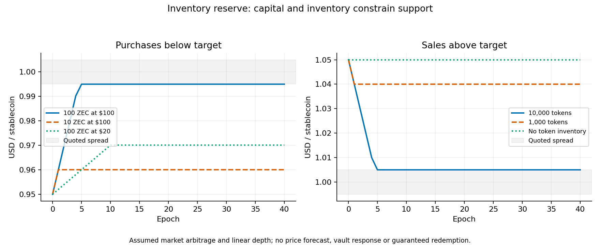

# Bounded reserve: implementation and adversarial results

Author: Giacomo Barbieri. Research prototype with synthetic balances and uncalibrated market assumptions.

The reserve exchanges existing ZEC and zUSD at a standing bid and ask. It conserves both assets, uses no activity rewards and needs only the ZEC/USD observation already required by vaults. It can support a price corridor while inventory, spending allowances and willing traders are available. Stale or compromised prices and fundamental stablecoin losses can still transfer value out of the reserve.

[Exact ledger](../analysis/reserve.py), [market study](../analysis/reserve_study.py), [results](../analysis/reserve-results.json), [trajectories](../analysis/reserve-trajectories.csv), [parameter grid](../analysis/reserve-sensitivity.csv) and [design](reserve-design.md) are included. This extends the [earlier bounty analysis](stabilization-math.md). Rust monetary rules and the compiled Zebra adapter remain unchanged.

## 1. Inventory and liability accounting

Let $M$ be total stablecoin supply, $H$ reserve inventory, $F=M-H$ market float, and $R$ reserve ZEC. The market study assumes every token outside the reserve circulates. Real holders may retain tokens, so this equality is a modeling assumption about float.

| Reserve operation | ZEC balance | Token inventory | Supply and liabilities |
|---|---|---|---|
| Buy $q$ tokens | Decreases by actual payment | Increases by $q$ | Unchanged |
| Sell $q$ tokens | Increases by actual payment | Decreases by $q$ | Unchanged |
| Hypothetical subsidy credit | Retains amount below funding target | Unchanged | Stablecoin supply unchanged; new ZEC recorded separately |

Purchased tokens remain inventory. Burning them without reducing a specified liability would break the existing supply/debt identity. Reserve inventory counts toward total supply even when it does not circulate.

The base fixture transfers 100 ZEC and 10,000 tokens from a named donor. Another account holds 80,000 tokens. Total supply and aggregate liabilities are therefore **90,000**, not 80,000. The fixture creates synthetic balances and matching aggregate liabilities; it does not prove collateral backing or replay valid vault issuance. A native implementation must consume existing valid asset inputs.

At a \$1 token valuation and \$100/ZEC, the base endowment is worth \$20,000: \$10,000 cash plus \$10,000 token inventory. Initial inventory is not free. If a common funding budget supplies both assets, acquisition of the tokens must be charged to that budget.

## 2. Exact exchange rules

Use integer token quantity $q_\mu$, $10^6$ micro-units per zUSD, $10^8$ zatoshi per ZEC, and accepted ZEC price $X_\mu$ in micro-USD per ZEC. Target-centered quotes are $b_\mu=995{,}000$ and $a_\mu=1{,}005{,}000$:

$$
z_{\rm buy}=\left\lfloor\frac{q_\mu b_\mu 10^8}{10^6X_\mu}\right\rfloor,\qquad
z_{\rm sell}=\left\lceil\frac{q_\mu a_\mu 10^8}{10^6X_\mu}\right\rceil.
$$

“Buy” means the reserve buys tokens and pays ZEC. “Sell” means the reserve sells inventory and receives ZEC. Rounding favors the reserve. Zero-output purchases reject; rejected orders leave all balances, nonces and counters unchanged.

Each order binds its actor, nonce, direction, amount, ZEC observation sequence, epoch, expiry and minimum ZEC received or maximum ZEC paid. Epochs derive from block height. The input state is immutable, and successful fills return a replacement state.

The core bounds stored balances and counters to unsigned 64-bit integers, using exact Python intermediates. A native implementation needs specified checked wide arithmetic and bounded decoding. This Python module does not verify signatures, authenticate reports or execute native transactions.

### Illustrative limits

| Parameter | Default |
|---|---:|
| Bid / ask | \$0.995 / \$1.005 |
| Epoch length | 10 blocks |
| Maximum ZEC observation age | 3 blocks |
| Gross ZEC paid per epoch / lifetime | 10 / 100 ZEC |
| Gross tokens sold per epoch / lifetime | 1,000 / 20,000 |
| Maximum token inventory | 40,000 |
| Minimum retained ZEC | zero |
| New-funding target | 100 ZEC |
| Active heights | 0 through 999 |

These values are test settings. The funding target limits retention of **new subsidy credits**. Sale proceeds stay in the reserve and can put its cash above 100 ZEC. Future credits then divert to the recorded NSM bucket until cash falls below the target. The bucket represents a proposed allocation; it does not implement the actual NSM recurrence.

Lifetime allowances never reset when assets are replenished. Sunset stops fills and funding-helper calls. Remaining balances stay accounted for; no wind-down, settlement or residual-inventory disposition is implemented.

### Trusted host boundary

The host supplies the exact branch state, one canonical unchanged policy, authorized orders and authenticated canonical observations. A sequence must denote one price and observation height. The host derives an authorized funding amount and once-per-block cadence; calling the funding helper repeatedly is not an emission-schedule check.

The Python module enforces transfer arithmetic, counters and supplied-policy limits under those preconditions. Native consensus must establish the preconditions itself. Passing policy or price fields from an untrusted transaction would be insufficient.

## 3. Conditions for price support

With unchanged correct ZEC conversion, a trader who buys and sells the same quantity through the reserve loses at least the spread, ignoring any outside trades:

$$
\Pi_{\rm cycle}\le-\frac{q_\mu(a_\mu-b_\mu)}{10^6X_\mu}
\quad\text{ZEC}.
$$

Flooring payouts and rounding charges upward cannot improve the trader's result. Splitting a fixed-price cycle does not create a positive profit. This removes the earlier bounty model's direct retained-token reward. It does not establish that all trading improves the external market.

For the assumed linear external market,

$$
p=1+\frac{Q-F}{A},
$$

the no-cost inventory interval supporting the quoted band is

$$
M-Q-A(1-b)\le H\le M-Q+A(a-1).
$$

It must intersect the available inventory interval. When $Q>M$, inventory sales alone cannot reach exactly \$1. Reaching even the ask requires $Q-M\le A(a-1)$ after selling all inventory. New valid vault issuance could change $M$; the reserve experiment does not model that response.

If $p_0<b$, purchasing $q=A(b-p_0)$ tokens reaches the bid under assumed full arbitrage. Required cash is approximately $qb/X$ ZEC, subject to integer rounding. If $p_0>a$, selling $q=A(p_0-a)$ tokens reaches the ask. A per-token transaction hurdle $h$ widens the effective support interval to approximately $[b-h,a+h]$.

The earlier controller's gain/delay bounds apply to its own assumed supply-response equation. Standing quotes use a different mechanism. This study does not claim to simulate delayed trader execution or prove real-market convergence.

## 4. Executed market scenarios

The base study starts with 80,000 circulating tokens, 10,000 reserve tokens, 100 reserve ZEC, depth 100,000 and correct \$100/ZEC conversion. Forty epochs are simulated. An epoch has no calibrated wall-clock duration.

| Scenario | Final token price | Tokens purchased / sold | Reserve ZEC paid / received |
|---|---:|---:|---:|
| Initial \$0.95, adequate cash | \$0.995 | 4,500 purchased | approximately 44.775 paid |
| Initial \$1.05, adequate inventory | \$1.005 | 4,500 sold | 45.225 received |
| Initial \$0.95, only 10 ZEC | \$0.96005 | approximately 1,005 purchased | 10 paid |
| Initial \$0.95, ZEC worth \$20 | \$0.97010 | approximately 2,010 purchased | approximately 100 paid |
| Initial \$1.05, no token inventory | \$1.05 | zero | zero |
| Initial \$1.05, 1,000 reserve tokens | \$1.04 | 1,000 sold | 10.05 received |
| Demand 100,000; total supply 90,000 | \$1.10 | all 10,000 inventory sold | 100.5 received |
| No willing participation | \$0.95 | zero | zero |
| \$0.01 per-token transaction hurdle | \$0.985 | 3,500 purchased | approximately 34.825 paid |
| Sunset after two epochs | \$0.97010 | approximately 2,010 purchased | 20 paid |
| Demand contracts 500 tokens/epoch | \$0.90794 | approximately 10,794 purchased | 107.4 paid |

The persistent-contraction case receives 0.2 ZEC per epoch and uses a larger lifetime ZEC allowance to expose cash depletion. Other assumptions appear in the checked-in results. The adequate purchase needs about **\$4,477.50 in capital** to reach the bid, rather than the earlier model's \$50 in bounties to approach \$1. These mechanisms purchase different services and have different participant-capital assumptions.

The exact purchase payments sum to 44.77499998 ZEC: two zatoshi below the continuous calculation because of per-fill floors. Every fill and conservation check uses integers. Fraction arithmetic determines the assumed external price and requested volume; floating-point values are used for presentation.

The 144-case grid varies cash, token inventory, ZEC price, demand direction and epoch sale allowance. It tests sensitivity of the assumed market linkage. Grid points have no probabilistic weight and imply no empirical success rate. There is no liquidation, collateral-price feedback or endogenous confidence model.

## 5. Adversarial results

### A fresh report can still be wrong

Let true executable ZEC price be $X$, accepted oracle price be $\hat X$, and true token price be $p$. The effective bid and ask in true dollars are $bX/\hat X$ and $aX/\hat X$. Holding true prices fixed during a fill, reserve value changes by:

$$
\Delta V_{\rm buy}=q\left(p-b\frac{X}{\hat X}\right),\qquad
\Delta V_{\rm sell}=q\left(a\frac{X}{\hat X}-p\right).
$$

These mark-to-market changes exclude price revaluation before the trade. Losses from a preceding ZEC gap can be additional.

| Accepted ZEC price | True prices | Hostile 10,000-token fill | Trader gain / reserve trade loss |
|---:|---|---|---:|
| \$100 | ZEC \$20; token \$1 | Buy reserve inventory for 100.5 ZEC | \$7,990 |
| \$100 | ZEC \$200; token \$1 | Sell tokens to reserve for 99.5 ZEC | \$9,900 |
| \$100 | ZEC \$100; token \$0.50 | Sell tokens to reserve for 99.5 ZEC | \$4,950 |

These single-fill examples enlarge the epoch caps to permit 10,000 units. Default smaller epoch limits rate-limit exposure; repeated epochs remain subject to the lifetime caps. Observation freshness, signatures and order limits do not prove price truth or protect a protocol bid against a fundamental token collapse.

The unchanged-price spread blocks a direct profitable round trip. It cannot provide a hard dollar-loss bound: a ZEC gap can revalue existing assets before any stop operates. Only physical token/ZEC bounds are enforced.

### Cheap occupation of intervention capacity

At correct \$100/ZEC conversion, an actor can sell 1,000 tokens to the reserve and buy them back. Holdings return to their original token quantity and the actor loses \$10 to the spread. The cycle consumes 9.95 of the 10-ZEC epoch payout allowance and all 1,000 units of the token-sale allowance. Subsequent 100-token orders in either direction reject.

This is availability grief, not a direct trading profit. External liquidation or manipulation profits could still motivate it. A global budget bounds spending but does not allocate access fairly. Wallet caps would not establish independent ownership.

Over 20 epochs, buying all 10,000 reserve tokens and then selling them back to the reserve costs the trader 1 ZEC while consuming 99.5 of the 100-ZEC lifetime purchase allowance. Cash and inventory recover, but most lifetime intervention capacity is occupied. Resetting gross counters after a cycle would weaken the intended loss limits.

### Working-capital drain found and fixed

The first design swept sale proceeds above a hard ZEC balance cap into the NSM bucket. A 20-epoch sale/buyback cycle could then restore all token inventory while reducing reserve cash from 100 ZEC to 0.5 ZEC, at a trader cost of 1 ZEC. It exported 100.5 ZEC to the NSM instead of preserving purchase capacity.

The regression failed before the fix. Retaining sale proceeds now leaves **101 ZEC, the original inventory and no NSM transfer**. The target applies only to new funding. The remaining lifetime-quota occupation is documented above.

## 6. Native Zebra requirements

The [integration proposal](zebra-integration.md) specifies the required reserve additions. Native code would need a fixed reserve value path, authenticated ZEC observations, branch-specific inventory and counters, signed swap bounds, exact asset conservation, schedule-derived funding credits and complete rollback. The reserve has no issuer, custody or discretionary spending key.

The included Python module and its tests are a separate reference state machine. The existing compiled Rust contextual adapter has no reserve operations. A future implementation must also specify shutdown and residual-asset disposition, resource costs, oracle compromise handling and funding policy before a value-bearing test.

## 7. What improved, and what remains weak

| Strength | Remaining weakness |
|---|---|
| Existing assets exchange atomically; no bounty or unbacked reserve mint. | Synthetic accounting does not prove backing or native input validity. |
| Fixed quotes require no new stablecoin-market oracle. | The ZEC oracle remains economically powerful; bad quotes transfer value. |
| A spread makes unchanged-price exact cycles costly. | Paid cycles can still occupy quotas or support profitable external strategies. |
| Gross per-epoch/lifetime limits and sunset bound physical exposure. | Limits can halt genuine support; dollar losses can exceed any prior expectation after gaps. |
| New-funding overflow preserves a bounded allocation target. | Market proceeds may put cash above the target, increasing ZEC exposure. |
| All supply and liabilities remain visible and unchanged by swaps. | Finite inventory cannot expand supply, absorb unlimited depegs or recapitalize bad debt. |

This experiment is a stronger accounting basis than raw activity rewards. Its market effectiveness, oracle robustness, allowance sizing and shutdown policy remain uncalibrated. The tests support further isolated native development; they do not establish production readiness.

The later [lifecycle experiment](reserve-lifecycle.md) specifies a retained-funding budget and terminal inventory sale. It preserves this study as the v1 baseline and documents the additional auction, outage and loss-allocation risks.
