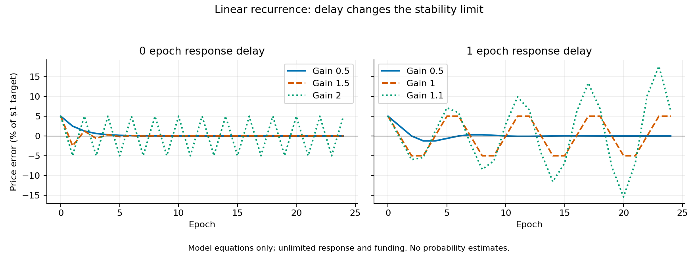
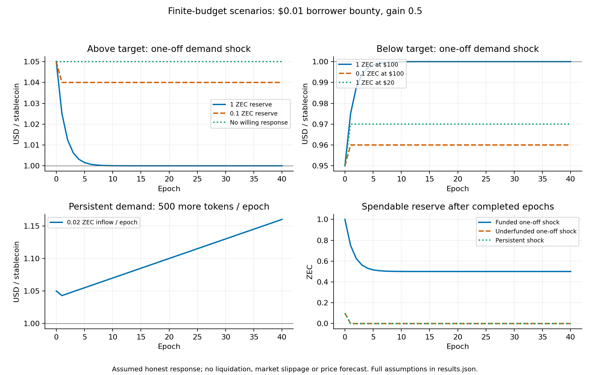

# Mathematical test of ZCG-funded stabilization

Author: Giacomo Barbieri. Research scenario; no funding allocation or reward mechanism has been approved or implemented.

A fraction of a grant-funding reduction can finance a bounded stabilization reserve. The arithmetic conserves ZEC. It does not establish that paying borrowers will stabilize the token: that conclusion depends on their market behavior, available collateral, oracle quality and response delay. The proposed raw mint/burn bounty fails an adversarial test because a participant can collect both rewards while retaining the tokens throughout.

The executable study has exact funding arithmetic, analytical controller bounds, 10 finite-budget scenarios, a 240-case parameter grid and economic counterexamples. [Numeric results](../analysis/results.json), [epoch trajectories](../analysis/trajectories.csv), [parameter grid](../analysis/sensitivity.csv) and [reproduction instructions](../analysis/README.md) are included. These are deterministic calculations with invented inputs, not forecasts or estimates of success probability.

## 1. Which funding reduction?

[ZIP 214](https://zips.z.cash/zip-0214) assigns 8% to ZCG and 12% to the CCF-labelled deferred pool, ending at the third halving, approximately 2028. [ZIP 255](https://zips.z.cash/zip-0255) specifies NU6.1; [ZIP 271](https://zips.z.cash/zip-0271) specifies its one-time deferred-pool disbursement. The ongoing 12% stream is still directed to `DEFERRED_POOL`. It is not an available ZSV treasury.

[ZCG's taper discussion](https://forum.zcashcommunity.com/t/zcg-gets-too-much-zec-heres-our-plan-to-fix-that/58566) proposes reduced grant funding through 2032, with roughly 3% monthly reductions and the remainder directed to the NSM. Its rounded comparison gives approximately 109,000 ZEC of future ZCG funding through the existing 2028 expiry versus 47,000 ZEC through 2032 under the proposal:

$$
C_{\rm future}\approx109{,}000-47{,}000=62{,}000\ {\rm ZEC}.
$$

Redirecting 10% of that net difference would give approximately **6,200 ZEC over the comparison horizon**. This excludes the separate proposed 36,200 ZEC treasury contribution. The 6,200 ZEC is neither an upfront balance nor a verified emission schedule. A schedule must specify the taper anchor, rounding, expiry, post-2028 allocation and how the retained grants are funded before a payable stream can be computed.

### Exact split against a renewed reference

For a separate illustrative calculation, assume an 8% reference continues for the whole horizon. Let month index be $m$, epoch scheduled subsidy be $B_m$, and the incentive fraction of the cut be $\alpha=0.1$. Define:

$$
g_m=0.08(0.97)^m,\qquad d_m=0.08-g_m,
$$
$$
G_m=g_mB_m,\qquad I_m=\alpha d_mB_m,\qquad N_m=(1-\alpha)d_mB_m.
$$

Then $G_m+I_m+N_m=0.08B_m$. The incentive share is below 0.8% of total scheduled subsidy for finite $m$. At month zero it is zero; prefunding would require a separate source. Geometric decay never reaches zero, so a 2032 sunset needs an explicit terminal rule.

| Month | ZCG share of scheduled subsidy | ZSV share | ZSV per 1 million ZEC of epoch subsidy |
|---:|---:|---:|---:|
| 0 | 8.0000% | 0% | 0 ZEC |
| 1 | 7.7600% | 0.0240% | 240.00 ZEC |
| 12 | 5.5507% | 0.2449% | 2,449.26 ZEC |
| 24 | 3.8513% | 0.4149% | 4,148.66 ZEC |
| 48 | 1.8541% | 0.6146% | 6,145.90 ZEC |
| 72 | 0.8926% | 0.7107% | 7,107.40 ZEC |

The last column normalizes the denominator; it does not predict actual epoch issuance. Halvings can reduce ZEC receipts even as their allocation percentage increases. ZEC price declines reduce the dollar spending capacity of those receipts. The study excludes reserve-dependent NSM reissuance. [ZIP 237](https://zips.z.cash/zip-0237) defines that recurrence; [ZIP 259](https://zips.z.cash/zip-0259) specifies its proposed activation parameters.

For integer zatoshi subsidy $b$, calculate:

$$
G_0=\lfloor0.08b\rfloor,\quad G_1=\lfloor g_mb\rfloor,\quad
\Delta=G_0-G_1,\quad I=\lfloor\Delta/10\rfloor,\quad N=\Delta-I.
$$

This preserves $G_1+I+N=G_0$ exactly, including rounding. `split_cut` rejects a proposed grant share greater than its reference share.

### Current-law comparison

Under the existing schedule the reference ZCG share becomes zero after its expiry. An extension then creates a negative budget difference. The correct aggregate is the **signed** sum of reference funding minus proposed funding, including those later costs.

The study demonstrates the effect with 72 idealized 30-day months, 54,000 ZEC/month before a halving at month 24, 27,000 afterward, and a fresh 3% taper from 8% at month zero:

| Reference schedule | Net grant reduction | 10% of net reduction |
|---|---:|---:|
| Existing expiry at month 24 | 2,375.40 ZEC | 237.54 ZEC |
| Renewed 8% through month 71 | 106,055.40 ZEC | 10,605.54 ZEC |

This normalization example does not reconstruct the forum's approximately 47,000 ZEC schedule. It shows why the reference and taper anchor must be fixed before quoting a budget. An aggregate saving also does not prove every intermediate cash balance is funded.

Redirecting part of the proposed cut reduces the amount otherwise entering the NSM. Until the existing expiry, a split within the same 20% share need not reduce the scheduled miner share. After the existing expiry, current rules leave miners 100% of scheduled subsidy; continuing a 20% allocation would leave 80%. Reserve-dependent NSM reissuance is a separate component. That extension needs its own security assessment and network upgrade.

## 2. A controller that can be solved analytically

Let $p_n$ be market price normalized to a \$1 target, $S_n$ circulating market float, $Q_n$ demand at the target, and $A>0$ demand depth in tokens per unit of normalized price:

$$
e_n=p_n-1=\frac{Q_n-S_n}{A}.
$$

Let $u_n$ be a signed change in float: positive for issuance reaching the market, negative for tokens bought from the market and repaid. Assume all requested action occurs, demand is fixed and no limits bind. A controller with gain $k$ requests $u_n=kAe_n$, giving:

$$
e_{n+1}=(1-k)e_n.
$$

Errors converge exactly when **$0<k<2$**. At $k=2$, they alternate without decaying. Higher gains diverge.

With one epoch of response delay:

$$
u_n=kAe_{n-1},\qquad e_{n+1}=e_n-ke_{n-1},\qquad
\lambda_{\pm}=\frac{1\pm\sqrt{1-4k}}2.
$$

Both roots are inside the unit circle exactly when **$0<k<1$**. At $k=1$, a six-epoch oscillation persists. For $1/4<k<1$, its envelope decays with modulus $\sqrt{k}$. If only fraction $\eta$ of the requested response executes consistently, replace $k$ by $\eta k$. At zero response there is no correction.

This is a local model. It assumes fixed depth and a known response. The dollar bounty and effective gain are independent inputs in the simulation; real participation would require estimating a response function $k(c)$. Reducing the assumed bounty toward zero cannot justify assuming the same response for free.

The simulated market price is an assumed observation. The Rust prototype's oracle supplies ZEC/USD only. A native peg controller would additionally need an accepted stablecoin-market observation, with its own liquidity, manipulation and outage analysis.

Total supply and market float are different quantities. The honest scenarios optimistically set them equal. Minted tokens retained by their borrower need not become sell-side liquidity. Reserve purchases can reduce float while leaving token supply and debt unchanged. Those inventory operations require separate accounting.

## 3. Finite reserve and collateral limits

Let $R_n$ be spendable ZEC, $F_n$ its funding credit, $X_n$ executable USD/ZEC price, and $c_n>0$ actual incentive spending in USD per eligible token. Beginning-of-epoch funding gives:

$$
|u_n|\le\frac{(R_n+F_n)X_n}{c_n},\qquad
R_{n+1}=R_n+F_n-\frac{c_n|u_n|}{X_n}.
$$

Here $c_n$ is a **borrower bounty**. The participant supplies collateral or repayment tokens. For a reserve buying tokens outright, use their full executable price plus costs, approximately \$1 near the target. The discount $1-p_n$ is not the purchase cost.

For example, 1,000 ZEC at \$20/ZEC can pay a \$0.02 bounty on one million eligible tokens. It can buy only about 20,000 tokens at \$1 before costs. Neither example grants every holder an enforceable redemption right.

At the model's 250% opening requirement, positive issuance also satisfies:

$$
u_n^+\le\max\left(0,\min\left(\frac{C_nX_n^{\rm oracle}}{2.5}-D_n,\ D_{\max}-D_n\right)\right).
$$

Borrowing freezes set this capacity to zero. Repayment is bounded by eligible debt and willing participants. Reserve ZEC and locked collateral ZEC are separate balances. Burning without reducing a named liability would violate the Rust model's supply/debt identity.

### Minimum correction cost

A one-off error requires net flow $A|e_0|$ to reach the target. With constant bounty $c$, the minimum total spending is $cA|e_0|$. Without delay:

$$
\sum_{n\ge0}|u_n|=
\begin{cases}
A|e_0|,&0<k\le1,\\
\dfrac{k}{2-k}A|e_0|,&1<k<2.
\end{cases}
$$

Thus a stable controller can still waste its budget through overshoot. Gain 1.5 requires three times the action volume of a monotone correction. Required spending diverges as $k\to2$. The stability proof ceases to establish recovery once a reserve, collateral or participation constraint binds.

For persistent disturbances requiring $v$ tokens of action per epoch, sustainable bounty spending requires $cv\le XF$. A reserve can bridge temporary deficits; it cannot cover an indefinite deficit. Even sufficient funding can leave a steady tracking error under a proportional controller responding to continually changing demand.

## 4. Executed finite-budget scenarios

Common starting inputs are 80,000 tokens of debt and float, depth 100,000, gain 0.5, no response delay, \$0.01 bounty, 2,500 locked ZEC, \$100/ZEC, and a 100,000 debt ceiling. The demand step changes the target quantity to 85,000 or 75,000, initially pricing the token at \$1.05 or \$0.95. Forty epochs are simulated. An epoch has no calibrated duration.

| Scenario | Final token price | Total bounty spending | Final spendable reserve |
|---|---:|---:|---:|
| Above target, 1 ZEC reserve | approximately \$1.0000 | \$50 | 0.5 ZEC |
| Above target, 0.1 ZEC reserve | \$1.0400 | \$10 | 0 |
| No willing response | \$1.0500 | \$0 | 1 ZEC |
| No collateral headroom | \$1.0500 | \$0 | 1 ZEC |
| Borrowing freeze | \$1.0500 | \$0 | 1 ZEC |
| Below target, 1 ZEC reserve | approximately \$1.0000 | \$50 | 0.5 ZEC |
| Below target, 0.1 ZEC reserve | \$0.9600 | \$10 | 0 |
| Below target, ZEC at \$20 | \$0.9700 | \$20 | 0 |
| Demand rises 500/epoch; 0.02 ZEC/epoch funding | \$1.1600 | \$90 | 0 |
| One epoch delay, gain 1.1 | \$0.9500 | \$100 | 0 |

The persistent-demand case starts with 0.1 ZEC. Required continuing correction costs \$5/epoch; funding supplies \$2/epoch. The delayed controller spends its entire reserve expanding supply past the target and cannot reverse the overshoot.

The 240-case grid varies gain, delay, response fraction, reserve and ZEC price. Its arbitrary grid weights have no probabilistic meaning. Every run checks nonnegative reserves, the debt ceiling and equal debt/supply changes. The grid is a sensitivity check of these equations, not an empirical validation of borrower behavior.

The crash case uses a lower constant ZEC price from the first epoch. It assumes eligible borrowers can still repay; it omits liquidations, slippage, insolvency resolution and endogenous demand loss. Its price recovery is consequently optimistic. `bad_debt` is only a borrowing-freeze flag in this study, not a second implementation of the Rust bad-debt ledger.

### Correlated ZEC risk

If ZEC falls to fraction $q$ of its price, the dollar value of a ZEC reserve and future ZEC inflow becomes $q$ times its previous value. USD-indexed bounty capacity falls proportionally. A vault starting at 250% collateralization falls to $250q\%$: liquidation becomes available below $q=0.8$, and full debt coverage including the 5% bonus requires $q\ge0.42$, before costs and rounding.

For a bounty fixed in ZEC per token, token payout capacity does not mechanically decline with price; the reward's dollar attractiveness declines instead. Neither denomination removes the correlated exposure. The simulator assumes oracle and executable prices agree; divergence would add another failure channel.

## 5. Adversarial mathematical tests

### Retain the tokens and collect both rewards

Mint $q$ tokens during an above-target reward epoch, retain them, then burn the same tokens during a below-target epoch after any age requirement. Debt, tokens and collateral return to their initial levels. There is no external purchase or sale. Global epoch netting still observes the requested mint and burn signs.

With dollar rewards $s_+,s_-$, collateral dollars per token $h$, annual financing cost $r$, holding time $T$ years and other costs $K$:

$$
\Pi=q(s_++s_-)-hq rT-K.
$$

For 10,000 tokens, one-cent rewards on both actions, $h=2.5$, $r=10\%$, one day and \$1 other costs, profit is **\$192.15 without an external trade**. At 30 days it is approximately negative \$6.48. Without fixed costs the break-even duration is 29.2 days. This assumes an attacker already holding enough ZEC or obtaining it at the stated financing cost; ZEC hedging or adverse price moves can add costs. Age requirements change that calculation but do not prove market impact. Delayed rewards must also be discounted.

### Wallet caps and trade rewards

A \$100 proportional reward pool with 1,000 honest units of weight and a 100-unit wallet cap gives a farmer \$9.09 using one wallet. Splitting 1,000 eligible units across ten wallets gives \$50 before added fees. The cap bounds an address, not beneficial ownership.

A self-trade can satisfy a volume rule while leaving consolidated holdings unchanged. A \$50 reward on \$10,000 matched volume with a 0.3% fee yields \$20 before other costs. Adding a trade condition alone does not fix the retained-token cycle.

### Manipulate the price trigger

In a constant-product pool with 1,000 tokens and \$1,000 quote reserves, ignoring fees, a 2% upward spot-price move requires \$9.9505 quote capital and returns 9.8525 tokens. The marked loss at the original price is only about **\$0.0980**:

$$
\Delta y=y(\sqrt{\rho}-1),\qquad
C_{\rm mark}=y(\sqrt{\rho}+\rho^{-1/2}-2).
$$

Capital required is not realized manipulation cost. With no fees or intervening trades, reversing the swap recovers the capital. Actual costs depend on fees, arbitrage, sampling and source independence. A signed report authenticates a reporter; it does not establish an economically secure market price.

### Pay for an action that would happen anyway

Let a participant's expected profit without subsidy be $a$, and the reward be $w$. A reward changes a simple participation decision only when $-w\le a<0$. At $a\ge0$, it can still change timing or scale, but observed participation alone does not establish additional stabilization.

For repayment, the unsubsidized value is $q(L-p)-K$, where $L$ is the participant's counterfactual value of extinguishing one debt unit. Assuming $L=1$ is a scenario assumption: ZSV does not give holders unconditional dollar redemption. On-chain flow records cannot establish that an external trade was independent or would not have happened without the reward.

## 6. What the test supports

| Property | Result |
|---|---|
| Funding conservation | Exact with integer rounding and an explicit reference schedule. |
| Local feedback stability | Proven for the stated linear response; delay narrows the permitted gain. |
| One-off correction | Possible with sufficient budget, collateral and assumed willing market response. |
| Permanent dollar support | Not established; finite reserves and unavailable borrowers leave persistent deviations. |
| Raw mint/burn rewards | Economically vulnerable to retained-token farming. Epoch netting and wallet caps do not repair it. |
| ZEC-funded reserve | Adds finite capacity while sharing collateral's ZEC drawdown risk. |
| Subsidy efficiency | Unknown without estimating incremental response and opportunity cost. |

The next mechanism worth testing is a bounded reserve that actually exchanges ZEC and stablecoins, with explicit inventory, execution-price limits and loss accounting. Purchases would retain inventory unless matched to a specified liability reduction; sales would require existing inventory or valid collateralized issuance. This can remain a fixed-two-asset design. It still faces adverse selection, oracle manipulation, finite reserves and consensus implementation costs.

The present results do **not** justify adding raw mint/burn rewards to Zebra. Before selecting a native mechanism, specify enforceable actions, delayed observations, inventory and bad-debt accounting, a reserve cap and sunset, spending limits, and how the mechanism behaves with no reliable stablecoin price. Then test its adversarial equilibrium and calibrate its response with market evidence.

The subsequent [inventory reserve study](reserve-study.md) implements standing bid/ask exchanges with exact balances and gross limits. It needs only the ZEC/USD conversion oracle and retains all purchased tokens. It documents oracle-driven losses, quota occupation and a working-capital flaw found and corrected during review.
