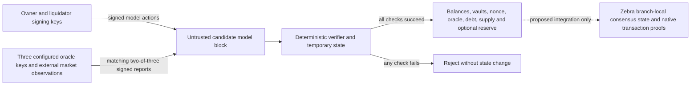

# ZSV threat model

Research scope: an isolated regtest reference state machine and a proposed native Zcash extension. This is not a deployed stablecoin, an audited consensus change, a shielded payment implementation, or evidence of a dollar peg. Severity describes consequences if the proposed system secured real value; the local prototype has no authorized connection to real funds.

The design fixes the asset domain to ZEC and one native USD-denominated unit, ZUSD. Vault debt creates ZUSD; repayment and liquidation consume existing ZUSD. There is no arbitrary asset registration, issuer key, arbitrary metadata, general smart-contract runtime, bridge or external settlement signer. Oracle trust, ZEC volatility, liquidation liquidity, proof correctness and consensus-upgrade risk remain.

## Evidence and classification

This model was prepared on 2026-10-29 from the local prototype, [economic review](economic-review.md), [proposed Zebra integration](zebra-integration.md), and the immutable upstream evidence in [sources.md](sources.md). The upstream baseline is Zebra `5faf8a413f0d30a6e93115f3d16af1e229fd7858` and ZIPs `2bdf39494320e5e04057ac93b1794031ebfb00b5`. Upstream links describe source interfaces, not a running patched node.

The Codex Security `threat-model` skill was read. Its four referenced policy/template resources could not be read through the skill tool. This document uses a source-based fallback at the user-designated path. No shared model cache was read or written. Its scope excludes a full security audit and independent exploit validation.

The model uses three classifications:

- Implemented observation: a behavior or boundary present in the local source. This may be intentional and is not automatically a vulnerability.
- Attack hypothesis: a concrete path conditional on attacker capabilities or missing deployment choices. It requires targeted validation; it is not a demonstrated exploit against Zcash.
- Production blocker: necessary functionality or specification absent from this prototype. A blocker prevents a production claim without implying that the isolated accounting model is broken.

### Implementation evidence map

| Implemented boundary | Source anchor | Evidence limit |
| --- | --- | --- |
| Exactly two assets; finite action enum | [`Asset`](../src/lib.rs), [`Action`](../src/lib.rs) | Constrains this model's parsed values; no shielded circuit exists. |
| Private mutable ledger; trusted regtest initialization | [`State`](../src/lib.rs), [`from_regtest_fixture`](../src/lib.rs) | Fixture ZEC is simulated, not a proof of an on-chain deposit. |
| Versioned signing encodings and strict signature check | [`SignedTx::signing_bytes`](../src/lib.rs), [`SignedOracleReport::signing_bytes`](../src/lib.rs), [`verify_strict`](../src/lib.rs) | Both transaction and oracle signatures now bind a canonical configuration/genesis-derived model-chain domain; general expiry and native activation digests remain separate work. |
| Limits, consecutive height, temporary-state execution and atomic commit | [`validate_block`](../src/lib.rs), [`apply_block`](../src/lib.rs) | No PoW, peer decoder, fork selection or durable storage. |
| Signed matching quorum, sequence and 100-block expiry bound | [`apply_oracle`](../src/lib.rs), [`fresh_price`](../src/lib.rs) | Authenticates an accepted tuple, not its external accuracy. |
| Per-account nonce and owner check | [`apply_transaction`](../src/lib.rs), [`owned_vault`](../src/lib.rs) | Keys and trusted initial configuration remain external assumptions. |
| Debt cap/floor, bad-debt mint freeze and collateral ratios | [`Borrow`](../src/lib.rs), [`Repay`](../src/lib.rs), [`Withdraw`](../src/lib.rs) | Parameter calibration and general recapitalization are absent. |
| Full liquidation, signed intent bounds and explicit shortfall | [`Liquidate`](../src/lib.rs) | Atomic accounting does not guarantee liquidator liquidity or inclusion. |
| Signed reserve trades, deterministic funding and shutdown | [`ReserveConfig`](../src/reserve.rs), [`ReserveState`](../src/reserve.rs) | Simulated ZEC schedule and NSM bucket; no native subsidy or durable state integration. |
| Permanent historical IDs and account creation | [`Open`](../src/lib.rs), [`Close`](../src/lib.rs), [`credit`](../src/lib.rs) | Reserve mode caps account count; historical IDs and storage cost still need a production bound. |
| Supply/debt/balance/ZEC conservation | [`check_invariants`](../src/lib.rs) | Accounting equality remains possible after economic insolvency. |
| Model-only checkpoint including immutable configuration | [`commitment`](../src/lib.rs) | JSON-based model fingerprint, not a Zcash block/transaction commitment. |

Source names are stable references; final source hashes and test results are recorded in [verification.md](verification.md). The initial review reproduced global identifier squatting and cross-configuration replay; both received test-first remediation before the final receipt.

## System, assets and trust boundaries

The executable implements a public account ledger with real Ed25519 authorization, public vaults, an authenticated canonical oracle report and deterministic integer accounting. The entry point processes ordered model blocks, not Zcash peer messages. ZEC in a model balance is not an on-chain UTXO or shielded note; a model vault does not encumber real ZEC. In reserve mode an elapsed outage deadline or sunset closes the reserve first. One optional block-level oracle update is then authenticated, deterministic funding is credited, and ordered user transactions execute. A producer cannot put a liquidation before that update or closure within the same model block, but can omit a report or select another valid certificate.

| Boundary | Trusted assumption | Attacker-controlled input | Required protection |
| --- | --- | --- | --- |
| Wallet to candidate block | Signing key remains secret; wallet signs the intended complete action list | Recipient, amount, vault identifier, nonce, action order, transaction signature | Verify authorization over a canonical domain-separated message; enforce ownership and balances independently. |
| Market to oracle reporters | A quorum signs accurate, recent, economically usable prices | Market manipulation, correlated data sources, compromised reporters, withholding | Cryptographic quorum authenticates reports; independent sourcing, governance and outage policy must address truth and availability. |
| Candidate block to model state | Rust process, configured genesis and initial fixtures are trusted | All proposed actions, oracle reports, ordering and height | Verify every block and atomically commit only valid transitions. A caller must not install its own post-state. |
| Model to actual Zcash collateral | Absent in v0 | Ordinary ZEC spends, competing vault spends, false membership claims | Native transaction semantics and parent-branch UTXO/note checks must make collateral genuinely unspendable outside permitted vault transitions. |
| Public issuance to future shielded pool | Absent in v0 | Forged proofs, unknown assets, mismatched public deltas, duplicate nullifiers | Reviewed fixed-asset circuits, per-asset conservation and mint/burn binding in the same native transaction. |
| Best chain to forks/finalized storage | Absent in v0 | Reorgs, competing spends, stale mempool state, crashes | Branch-local state, atomic persistence, rollback and replay equivalence. |
| Protocol governance to users | Parameters and oracle set are chosen by a future consensus process | Coercion, captured upgrade process, rushed emergency changes | Explicit review, activation and change rules; no hidden operator override or external signer. |

Assets to protect are collateral custody, owner authorization, ZUSD supply integrity, liability accounting, oracle integrity, validation determinism, availability, and users' transaction information. Dollar purchasing power is an economic objective that depends on external markets; the ledger cannot enforce a one-dollar market price.

## Security and monetary invariants

The model must enforce these invariants:

1. Wallet ZEC, vault collateral, reserve cash and the NSM bucket together equal finite genesis ZEC plus cumulative scheduled fixture funding. The immutable reserve schedule defaults to zero funding and is credited once per accepted block. There is no user-callable faucet transaction.
2. `ZUSD supply = sum(public ZUSD balances) + reserve inventory = active vault debt + explicit bad debt`. A transfer or reserve swap changes neither supply nor debt. Repayment, liquidation and reserve shutdown burn actual units exactly once against a matching liability reduction.
3. Only a vault owner can borrow, withdraw or close that vault. Permissionless liquidation is the narrowly defined exception; it cannot select an arbitrary seizure amount.
4. New debt and debt-bearing withdrawals satisfy the exact post-operation 250% collateral ratio at a fresh accepted price. Nonzero vault debt is at least 100 ZUSD. Total liabilities stay within 100,000 ZUSD. These prototype parameters remain uncalibrated.
5. A vault is liquidatable only below the exact 200% threshold. Full close burns `x = min(D, floor(C*P*100 / (q*105)))`, seizes `ceil(x*q*105 / (P*100))` zatoshi, returns the remainder to the owner, removes the vault, and records `D-x` as bad debt. `q` is zatoshi per ZEC and `P` is micro-USD per ZEC. No calculation creates collateral to hide a shortfall.
6. Any positive bad debt freezes new borrowing. The freeze contains additional issuance without recapitalizing existing units. Any resumption rule must reduce the recorded shortfall by burning real units or use a separately specified mechanism.
7. The accepted oracle tuple has positive price, the required distinct configured signatures and deterministic replay/freshness rules. Node-local time, prices or network queries cannot choose a consensus result.
8. A rejected action, transaction or block leaves balances, vaults, nonces, oracle state, debt, supply, reserve counters, funding, lifecycle state and height unchanged. Successful operations use checked integer arithmetic with specified floor/ceiling behavior.
9. No unknown asset tag, arbitrary issuer, generic mint operation or caller-asserted `proof_valid` flag can authorize issuance.
10. Initial reserve cash plus later retained funding never exceeds its immutable budget. Sale proceeds do not restore funding headroom. Normal fills share epoch allowances; closed reserves cannot resume trading on the same branch. Closure burns only existing reserve tokens against bad debt recorded before user transactions; later losses are not covered retroactively.

The [economic review](economic-review.md) explains rounding, insolvency and the zero-affordable-burn edge case. The accounting identity can remain true after collateral losses and insolvency.

## Attacker matrix

| Attacker | Capabilities assumed | Valuable goals | Important limits |
| --- | --- | --- | --- |
| Unprivileged participant | Creates keys, funds own model account, signs arbitrary valid actions, submits malformed candidates | Unauthorized withdrawal, debt-free issuance, nonce replay, dust/state growth, cap exhaustion | Cannot forge another key or rewrite trusted genesis. No assumption that one key equals one person. |
| Malicious borrower | Chooses the debt/collateral ratio, timing, recipients and liquidation exposure | Sell overvalued newly minted units; extract collateral before a price correction; externalize a shortfall | Borrow/withdraw constraints and debt ceiling restrict valid transitions, but depend on the oracle. |
| Liquidator/searcher | Holds ZUSD, monitors public vaults, races other liquidators | Capture bonus; exploit stale or false prices; exclude competitors | Needs existing units and inclusion. Atomic settlement does not ensure market liquidity. |
| One oracle operator | Signs, delays or supplies false data with one configured key | Stall or bias accepted prices, grief quorum coordination | Cannot alone satisfy a two-of-three threshold if identities and messages are checked. Shared sources can still corrupt honest reports. |
| Two oracle operators / common compromise | Produces an authorized quorum for an arbitrary tuple | Inflate price and mint inadequately backed debt; depress price and seize healthy collateral | Cryptographic verification accepts properly authorized lies. Global cap limits nominal issuance, not theft percentage. |
| Block producer | Chooses inclusion/order and can censor while its block wins | Liquidation ordering profit, cap capture, delayed price correction | Cannot forge signatures or include a transition rejected by all honest consensus nodes. Persistence of censorship depends on block production power. |
| Peer/resource attacker | Sends large or computationally expensive inputs in a future network adapter | Memory, CPU, disk or validation exhaustion | No network server is implemented in this prototype; production limits must exist before deployment. |
| Passive observer / coercive counterparty | Reads every public balance, vault and action; correlates external identities | Identify debt/collateral ratios and payment graph, discriminate by provenance, target liquidations | Public v0 promises no payment confidentiality. Future shielding needs a separate analysis. |
| Compromised wallet/dependency or governance coalition | Steals keys, changes software, influences a future upgrade | Validly authorize theft, replace oracle/risk rules or ship an unsound circuit | Transaction signatures cannot protect a user whose signer or client is compromised. |

## Concrete attack paths and residual risk

| ID | Conditional severity | Classification | Attack path and consequence |
| --- | --- | --- | --- |
| T1 | Critical | Design trust assumption | Control two oracle keys, or manipulate their common source; submit a high price; borrow at a nominal 250%; sell units; restore the true price. Minted units survive the correction with insufficient real backing. Alternatively submit a false low price and liquidate a healthy borrower. |
| T2 | High | Implemented economic limitation | Cause or wait for a ZEC price gap; liquidators cannot acquire enough ZUSD or lack inclusion; full close realizes bad debt. Holders bear a depeg/loss because no unconditional holder right to redeem for dollars or collateral exists. |
| T3 | High | Implemented outage tradeoff | Withhold oracle reports or censor updates until expiry. Borrowing, debt-bearing withdrawals and liquidation require freshness and stop; unsafe collateral can deteriorate while liquidation is unavailable. Repayment, owner collateral additions and debt-free closure remain available. Permitting stale liquidation instead would introduce wrongful-seizure risk. |
| T4 | High | Ordering hypothesis for proposed integration | Observe public positions and update timing; include a liquidation or borrower action at a favorable accepted price, exclude the competing correction/action, or capture the global mint budget. This can be valid consensus behavior. |
| T5 | High | Implemented privacy limitation | Read balances, owner public keys, collateral/debt, transfers and liquidation thresholds; correlate funding with an identity and discriminate or target that user. The current executable has no shielded pool. |
| T6 | Critical | Production blocker | Treat a wallet-level enum or existing ZEC proof as sufficient for new shielded assets. A missing allowed-base, asset-binding or per-asset conservation constraint permits unauthorized assets, conversion or inflation even if the account model is correct. |
| T7 | Critical | Production blocker | Implement ZSV only in a wallet, mempool, external service or best-chain cache. A block bypasses policy, a side branch borrows against stale state, or a reorg preserves an orphan mint while restoring collateral. |
| T8 | High | Production blocker / resource hypothesis | Feed oversized encoded collections or many individually valid candidates; allocate before checking counts; repeat signature verification and full-state copies. Local action limits alone do not bound network decoding, aggregate block cost or persistent state growth. |
| T9 | High | Model reproduction remediated; native integration still requires its own domain | The initial network-only signature allowed transaction and oracle replay across distinct configured regtest chains. Final signatures bind a canonical genesis/configuration-derived domain and reject that replay. Identical canonical genesis/configuration intentionally represents the same model chain; native branch/version activation domains still need specification. |
| T10 | High | Governance/liveness design blocker | Lose two configured reporter keys or require emergency rotation. With no specified rotation/settlement path, price availability can stop indefinitely; an ad hoc override would add undeclared authority. |
| T11 | Medium–High | Economic availability hypothesis | Fill the global debt ceiling with valid positions, grow owner-scoped historical identifiers, or leave the smallest possible positive bad debt. New borrowing becomes unavailable despite no signature forgery. |
| T12 | High | Operational production blocker | Reuse deterministic example seeds, leak a real owner/oracle key, or accept a trusted fixture as a deposit interface. Valid signatures then authorize theft or a false market price; the model provides no production custody boundary. |
| T13 | High | Implemented reserve tradeoff | Censor reports until the fixed outage deadline, then buy auction inventory under weak competition. Cash has already moved to the NSM bucket; remaining bad debt or later liquidation losses remain uncovered. |
| T14 | High | Implemented economic limitation | Use an authorized but false conversion price to buy cheap reserve tokens or receive excessive ZEC. Gross epoch and funding caps bound some physical exposure, not dollar losses or an enduring peg. |

### Oracle authenticity, source quality and freshness

Distinct authenticated signatures and one tuple in each accepted update prevent duplicate-signer quorum and disagreement among validators executing the same branch. They do not prove an exchange price, independence of reporters, or resistance to quorum collusion. With only three keys, one key's failure is tolerable for availability only while the other two remain honest, online, mutually coordinated and included. Two malicious keys are sufficient for an authorized false price. A single manipulated common exchange can undermine all three without stealing a key.

Two-of-three signatures are not Byzantine agreement. If the two honest reporters sign different tuples at one sequence, one equivocating reporter can sign both and create two valid certificates. The implementation has no reporter agreement or equivocation penalty protocol. Block order and the monotonic sequence select one price on each branch, so identical blocks still validate the same way. Producers can select among certificates, resulting in different price state on competing branches.

The prototype accepts a strictly advancing nonzero sequence, matching positive price/expiry tuples and two or three distinct configured signatures. Report expiry cannot be more than 100 model blocks after inclusion. Reserve quotes additionally enforce inclusion age and pause after it expires. Vault valuation retains the existing signed-expiry rule. Neither proves observation time: the format has no signed market-observation timestamp, and a quorum can republish old market data under a higher sequence. An extreme authorized `u64` price can also make checked `u128` ratio arithmetic fail closed until a newer usable report arrives; repayment and debt-free exit do not depend on valuation.

Before the system secures real value, specify independent source selection, market-quality and numerical price bounds, maximum report validity, inclusion/expiry policy, equivocation handling, key management and a reviewed rotation mechanism. Any price-deviation circuit breaker must specify deterministic behavior and can trade fast correction for availability; it cannot establish truth. Consensus must use committed parent-branch state and deterministic height/time rules. Height freshness is not a wall-clock guarantee when blocks slow. Residual risk includes authorized false reports, source correlation, outages and censorship.

### Authorization and economic intent

The model's strict Ed25519 signatures bind its fixed versioned message domain, network, canonical configuration/genesis-derived chain domain, signer, account nonce and complete tagged action list. Fixed-width integer encodings and distinct transaction/oracle domains avoid relying on JSON field order for authorization. Ownership and balances are checked after signature verification. These checks reject field mutation, forged authority and nonce replay on one history.

Liquidation signs and checks `oracle_sequence`, `max_burn` and `min_collateral` before any balance changes. A producer holding that transaction cannot execute it after a different accepted oracle sequence, and execution must remain within the signed burn/receipt bounds. Wallets must choose meaningful bounds: an unlimited maximum and zero minimum provide weaker protection.

The envelope binds a model chain derived from sorted configured oracle keys and sorted initial allocations; reserve mode also binds every reserve parameter, its initial donor and cash contribution. Different configurations or allocations produce different domains. Identical canonical genesis/configuration deliberately represents the same model chain, so forks retain a common domain. Reserve swaps sign quantity, direction, report sequence, epoch, expiry and slippage bounds; auction buys sign quantity, expiry and maximum ZEC input. The envelope has no general deadline for older vault actions. A production envelope still needs native genesis/network-upgrade domains, relevant Zcash transaction digests and an explicit validity policy for each operation. Intent bounds cannot guarantee inclusion, a truthful price or wall-clock freshness. Native note/outpoint membership and proof authorization remain separate missing checks.

The Rust process and its dependencies are trusted here. `ed25519-dalek`, `serde` and `sha2` are security-relevant dependencies; the lockfile supports reproducible versions but does not establish their safety. A compromised build, dependency or signer can bypass the intended rules or disclose keys. Production needs reproducible build/dependency review and key custody. Fixture seeds are public examples; the prototype has no key-management implementation.

### Solvency, liquidation and the peg

The 250% opening ratio reaches the 200% liquidation boundary after a 20% price decline, assuming unchanged debt and collateral. A 5% bonus needs collateral worth at least 105% of debt to fund full principal repayment. A further 47.5% gap from exactly 200% crosses that affordability level. These calculations assume a usable price and execution.

An attacker may exploit an oracle lag, but a crash with no adversary can cause the same loss. A full-close operation simplifies atomic accounting and avoids repeating partial rounding; it concentrates liquidity requirements and can crystallize losses. A tiny shortfall can halt all new borrowing; a debt minimum does not prevent tiny shortfalls after price movement. Optional reserve closure covers existing bad debt only up to its token inventory. That one-time burn precedes user transactions, so a liquidation later in the closure block can create new uncovered debt. The original vault-only mode has no coverage action. Neither mode has a general recapitalization mechanism.

There is no interest, stability fee or unconditional holder redemption. The optional reserve uses scheduled simulated funding and bounded standing quotes. Borrower repayment can contract supply below peg and new borrowing can expand it above peg, but both mechanisms depend on willing, funded participants and can be blocked by caps or pauses. Production requires explicit loss allocation and settlement, market-depth and stablecoin-liquidity stress tests, and a justified oracle/parameter design.

### Public information and future proof boundaries

Public vaults reveal owner keys, collateral, debt and the exact liquidation boundary; public balances and transfers reveal payment history. A separate future shielded payment pool could improve transfer privacy while leaving vaults public. It would not automatically hide issuance timing, redemption timing, public amount correlations, exchange interaction, small anonymity sets or network metadata.

Before claiming shielding, define the note plaintext, asset identifier, commitments, nullifier domain, allowed asset bases, per-asset balance equations, public mint/burn commitments, viewing-key behavior and wallet encryption. Bind public issuance to the same transaction's proof statement and forbid arbitrary assets inside the circuit, not only in JSON or a wallet. Review proof version/verification-key selection and caches independently. No such proof or privacy claim is established by the current account model.

### Consensus, reorgs and denial of service

The proposed [Zebra integration](zebra-integration.md) separates the required transaction parsing/digests, proofs, semantic checks, contextual execution, fork state, finalized storage and mempool revalidation layers. All enforcement must occur in native consensus; an external service returning “valid” or an ordinary ZEC payment carrying a vault label does not lock collateral.

Required invariants include same-block cumulative cap enforcement, duplicate vault/nullifier rejection, oracle application order, exact rollback of oracle/debt/supply/nonces, and replay equivalence after restart/finalization. Validate a side branch against its parent, not current best-chain state. Mempool acceptance cannot reserve collateral or mint budget permanently. Signature/proof caches need domains covering network, activation, proof version and all relevant signed bytes.

The current block limits are 256 transactions, 64 actions per transaction and 1,024 actions per block, and oracle updates contain at most three reports. These checks bound some work after the caller has constructed a block; they do not bound the preceding serde allocation. Validation clones the full state and scans every account and active vault. Reserve mode enforces an immutable account cap, defaulting to 1,024; valid Sybil accounts can occupy that capacity. The original vault-only mode has no account cap. The historical owner-scoped `used_vault_ids` set is never pruned or globally bounded in either mode.

A concrete resource path uses one zatoshi repeatedly: open a debt-free vault at a fresh ID, close it to recover the same zatoshi, and repeat. Each cycle permanently grows `used_vault_ids` without incurring debt or a protocol fee. Transfers through fresh keys can similarly leave zero-balance accounts behind. The initial global-ID scheme additionally let an attacker reserve a victim's requested integer ID; the final owner-scoped namespace removes that cross-owner denial. Repeated churn within one owner's namespace still grows history. This model-state growth is confirmed; no peer service is deployed. Reviewed state limits, reclamation and resource pricing must address growth. All must preserve replay safety.

Before exposing a decoder to peers, bound bytes and collection lengths before allocation, enforce aggregate block cost and persistent-state limits, and price validation/storage resources. Model-level transaction/action counts do not substitute for these checks. No-fee experiments cannot establish that production blockspace or long-term state remains available under Sybil load. Valid borrowers can still occupy scarce debt capacity under any finite global cap; a cap is not an admission-fairness mechanism. The tiny-bad-debt freeze requires an explicit loss/reserve/coverage policy, not silent rounding away of liabilities.

### Stabilization reserve

The separate [funding study](stabilization-math.md) evaluates a hypothetical allocation from reduced future ZCG funding. Its activity-bounty controller would need a stablecoin-market observation in addition to ZEC/USD. The later [inventory reserve experiment](reserve-study.md) uses standing bid/ask quotes with the ZEC/USD conversion report alone. The signed Rust ledger now implements those trades with the [lifecycle policy](reserve-lifecycle.md), actual model vault issuance and immutable fixture funding. No Zcash funding allocation has been approved.

An adversary can mint in one rewarded epoch, retain the tokens and burn them in a later rewarded epoch. Accounting and debt age can be valid while no independent market trade occurs. Wallet caps are Sybilable; matched trades can manufacture volume. Thin-market price manipulation can also trigger rewards. A global budget bounds the reserve loss but does not prevent capture.

Before adding a native mechanism, define its price sources and compromise response, inventory and liability accounting, spending limits and shutdown behavior. Delay and reserve depletion can destabilize an otherwise valid feedback rule. Holding both collateral and incentives in ZEC exposes them to the same drawdown. The current research model gives no evidence of a secure production reward mechanism.

The standing-quote spread makes an exact unchanged-price round trip costly, while wrong ZEC conversion and a fundamental token depeg can still transfer value to traders. Losing cycles can occupy gross quotas without improving the external market. An early sale-proceeds sweep enabled working-capital grief; the corrected funding target retains those proceeds. Physical caps do not guarantee a dollar-loss bound. The Rust integration replaces Python's trusted order/funding inputs with signatures, configuration-bound policy and a deterministic schedule. Market truth remains external, and native coinbase/NSM validation is still absent.

### Governance and scope of the native restriction

The [lifecycle policy](reserve-lifecycle.md) replaces lifetime gross stops with retained-funding limits while preserving epoch rates. That removes permanent capacity exhaustion from the tested recycled-capital path; same-epoch quota occupation remains. The Python experiments use a separate initial token endowment. Rust starts with zero reserve tokens and debits initial cash from a named genesis donor; inventory must come from issued tokens transferred through signed trades.

Oracle censorship can trigger the fixed outage deadline and force a wind-down auction. Review of the Python policy fixed stale observations restarting that deadline and removed a free terminal distribution that rewarded borrowing before its snapshot. Rust closes an elapsed outage before accepting a report that could resume trading; a newly included quorum report before the deadline still counts as fresh regardless of market-data age. The auction avoids conversion-oracle dependence but remains exposed to censorship, poor competition and coarse price steps. Returning reserve cash to NSM can leave uncovered bad debt. The contextual adapter now prepares the combined model state; native fork storage and restart behavior remain unimplemented.

Omitting a generic issuer/admin key removes one route to unilateral minting. Oracle keys still carry economically powerful authority. Risk parameters, key-set replacement, emergency behavior, activation and insolvency policy remain governance decisions even if implemented only through a consensus upgrade. Define those rules and their delay/failure behavior before deployment; do not quietly add an operator escape hatch.

The fixed asset domain can prevent additional native issuance through this extension. It cannot prevent inscriptions, external IOUs, custodial ledgers, wrapped claims, sidechains, derivatives, speculative trading, or applications labeling ZEC payments as meme assets. It also cannot prevent speculation in ZUSD.

## Strengths and costs of the restricted design

| Strength relative to a general asset facility | Cost or remaining weakness |
| --- | --- |
| Two fixed assets reduce asset discovery, parser cases, issuer authorization and cross-asset accounting. | New asset proofs and transaction formats remain consensus-critical; fewer assets do not make new cryptography safe. |
| Debt creation is the sole mint route; no independent issuer can create a series. | Borrowers and oracle quorums can still create economically bad debt within valid rules. |
| Public vaults and explicit debt/bad debt make accounting inspectable. | Borrowers and payments lose confidentiality; auditability does not establish market solvency. |
| Checked integers, exact rounding and atomic transitions permit deterministic review. | Production parsing, branch-local state, persistence and proof binding are still absent. |
| Full liquidation gives one bounded burn/seizure calculation. | Liquidators need the full affordable amount and usable market liquidity. |
| Debt ceiling, minimum debt and mint freeze limit some exposure and dust. | Parameters lack calibration; caps can be captured and small shortfalls can halt issuance. |
| No runtime, bridge, arbitrary issuer or hidden external settlement process is needed. | Market information remains external, and governance and oracle operations remain trusted boundaries. |

## Validation and release blockers

The existing adversarial tests describe checks for replay, wrong-network signatures, action tampering, owner authorization, duplicate/unregistered/inconsistent oracle reports, stale-price safe operations, unknown assets, oversized batches and rejection atomicity. Test source is evidence of intended coverage; only a recorded successful run supports a passing claim. The independent code review and root test results are separate from this document.

Before any production claim, retain reproducible evidence for:

1. Cross-implementation canonical serialization/signature/digest vectors, wrong-version/branch replays, invalid keys and every signed-field mutation.
2. Integer boundaries around 250%, 200%, 105%, debt floor/cap, zero-affordable burn and maximum values; state conservation across successful and rejected multi-action blocks.
3. Oracle compromise, equivocation, maximum validity, stalling and same-block ordering; source and operator independence cannot be established by unit tests.
4. Native collateral unspentness and fixed-asset mint/burn proof binding, adversarial circuit tests and independent cryptographic review.
5. Fork/reorg, restart, database migration and finalization equivalence on a real isolated patched node.
6. Bounded decode/verification/storage costs measured against hostile input and sustained state growth.
7. Explicit key rotation, loss allocation, settlement and emergency governance; liquidation liquidity and depeg stress results.
