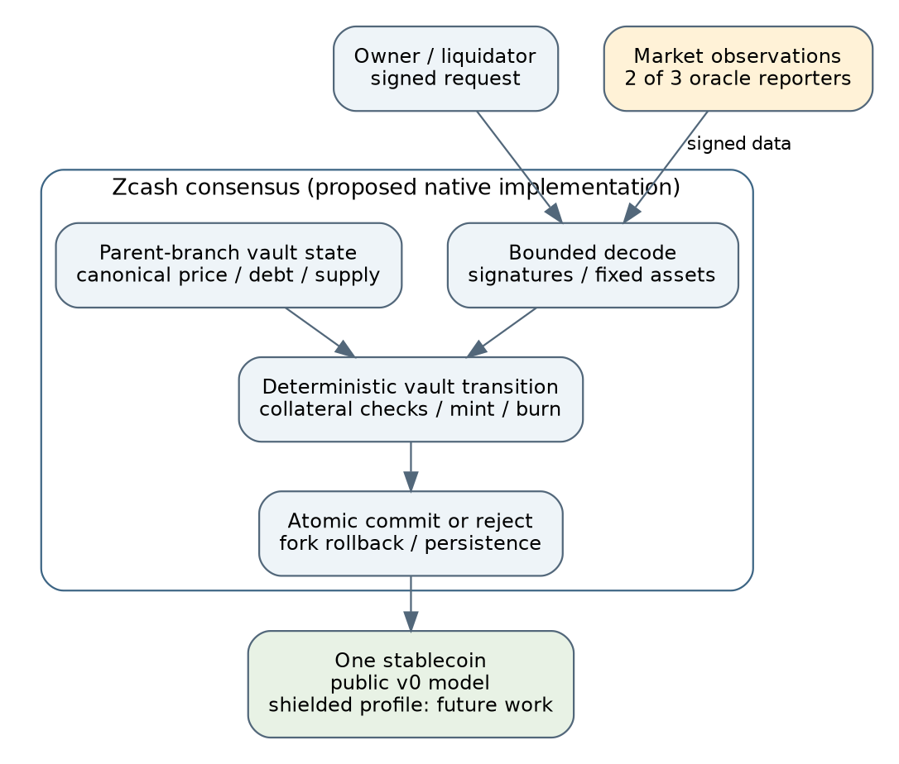

# Abstract

Zcash Stablecoin Vault (ZSV) is a proposed consensus extension for locking native ZEC and issuing one dollar-targeting stablecoin on Zcash. Its purpose is narrower than general-purpose Zcash Shielded Assets (ZSAs): ZEC and a single protocol-defined stable asset are the complete asset set. There are no arbitrary issuers, token descriptions, asset registration transactions, NFTs, liquidity tokens, governance tokens or programmable asset factories.

ZSV couples stablecoin issuance to collateralized debt, repayment to token destruction, and liquidation to atomic exchange of debt tokens for collateral. All proposed authorization and state-transition rules are verified by Zcash full nodes. Price observations remain an external trust input, but their acceptance, freshness and use are consensus rules. No external chain, bridge, custody committee or application server determines whether a vault can spend its collateral.

The repository provides a regtest-only Rust account-ledger model, signed requests and oracle observations, economic analysis, threat modeling, adversarial tests and a source-pinned Zebra integration proposal. It does not provide a mainnet-compatible Zebra node, production cryptography integration, shielded stablecoin transfers, a proven dollar peg or a deployed financial product. The protocol described here is original design work; cited Zcash proposals supply context rather than approval.

# Motivation and boundaries

ZEC holders may want dollar-denominated payment liquidity without selling all of their ZEC. A collateralized debt protocol can supply that liquidity by issuing debt tokens against overcollateralized vaults. The holder retains upside exposure to the remaining collateral and accepts liquidation risk. Stablecoin holders instead acquire exposure to collateral valuation, liquidation execution, oracle honesty and protocol solvency.

General-purpose asset issuance makes it possible to represent many assets, including speculative tokens. ZSV explores a different product decision: permit one useful additional monetary instrument while withholding a general token-launch interface. A smaller asset surface can reduce registry state, issuer authorization cases, wallet discovery complexity and some misuse opportunities. It does not eliminate the financial, privacy and consensus risks of an additional asset.

The enforceable goal is **no arbitrary native asset issuance through ZSV**. The protocol cannot prevent off-chain IOUs, inscriptions, wrapped derivatives, external-chain tokens, speculative trading or future Zcash upgrades. It cannot determine the social meaning of a payment. The design therefore avoids claiming that it can ban memecoins across the entire ecosystem.

# Design alternatives

The selected route is a dedicated native vault bundle with a fixed state machine. This has a larger consensus-specific implementation than an ordinary wallet application, but its permitted behavior can be enumerated and reviewed.

A general proof-verification or predicate layer is another possible route. It could support private applications and flexible computation, but requires rules for program identity, permitted issuance, execution limits and data availability. If deployed openly, it could recreate general-purpose issuance. ZSV does not need that surface for its first experiment.

External smart-contract execution and threshold custody are excluded because the requirement is native Zcash enforcement. An off-chain service may propose a transaction or generate a proof; it must never gain discretion to make an otherwise invalid transaction valid.

Zcash has relevant prior architecture work. ZIP 222 describes consensus-distributed verification of complex transparent spending preconditions [S1]. Its experimental implementation was removed in June 2026 and is not an available mainnet facility [S2]. More recent work includes an extensible transaction format [S3] and research on private programmability [S7]. These are design resources, not deployment commitments.

# Implemented model and proposed native system

The executable prototype uses an account ledger to make balances, authorization and invariants easy to inspect. Its state includes simulated free ZEC, stable balances, vault collateral and principal, account nonces, the accepted oracle observation, outstanding supply and explicit bad debt. A model genesis fixture supplies simulated ZEC. Real Ed25519 signatures authenticate model requests; they are not a substitute for Zcash transaction signatures or spend proofs.

The production proposal instead requires native transaction encoding, a designated vault value path, branch-specific contextual state, correct Zcash digests, wallet construction and atomic node state commits. Account-ledger behavior must not be mistaken for a drop-in replacement for Zebra's UTXO and shielded-note accounting. The integration document identifies concrete upstream files and acceptance gates against a pinned Zebra commit [S8].

The model is regtest-only and has no peer-to-peer service, miner, payment endpoint, real-fund deposit address or mainnet activation. Public vault data and public stable balances are implemented. Shielded stablecoin payments are a separate future component. There is no production claim based on a successful local demonstration.

# Asset restriction and selective ZSA reuse

The native design recognizes exactly two assets: ZEC and a protocol-defined stablecoin provisionally called zUSD. No user-selected identifier, asset description, issuer key or mint authority is accepted. Its target unit is the US dollar; replacing it with a different instrument is a protocol change.

ZIPs 226 and 227 propose general shielded asset transfer/burn and issuer-authorized creation [S4,S5]. ZSV can investigate reusing:

- Per-asset conservation and value-commitment techniques.
- Asset-aware note encryption and wallet scanning.
- Reviewed arithmetic and circuit gadgets appropriate for two fixed assets.
- Atomic multi-asset value flows, where compatible with the restricted design.

It intentionally excludes generic issuance bundles, arbitrary AssetIds, arbitrary issuer-defined assets, asset metadata registries, supply-finalization controls and NFT modes. The stablecoin's creation authority is the validated vault transition itself. A successful issuer signature is never an alternative authorization path.

At the wire-format and circuit level, every place that introduces an asset tag must constrain it to the two-element set. Restricting a wallet menu is insufficient. Asset equality, value conservation and stablecoin mint/burn authorization must remain bound throughout proof verification and contextual checks. Any reuse creates a new protocol profile requiring independent analysis; existing ZSA audits cannot simply be inherited as a certificate for ZSV.

QEDIT describes ZSAs as feature-testnet software requiring community mainnet activation [S6]. ZSV is an alternative scope proposal, not a claim that ZSAs are deployed or that a narrow subset is already available.

# Vault state and authorization

A proposed native vault stores its owner authorization, collateral C, principal D, version and data needed for any future fee calculation. Vault state must have a unique current instance. A transition consumes that instance and creates exactly one valid successor or closes it. Owner authorization is necessary for borrowing and withdrawing but insufficient to override collateral rules.

Collateral cannot remain spendable by an ordinary payment signature, an issuer key or an alternate transaction type. The node must recognize the vault encumbrance throughout locking, successor creation and release. Duplicate successors, replayed spends, cross-network authorizations and reuse of a stablecoin burn must fail.

The reference model signs an explicit action encoding and nonce in an immutable model-chain domain derived from the canonical regtest configuration and genesis allocations. Transaction and oracle signatures both bind that domain. Vault IDs are scoped by owner public key and a local integer; a different owner cannot reserve that namespace by opening and closing the same local number. Identical canonical configuration and genesis allocations deliberately represent the same chain, including its forks. Its binary authorization format is an experimental model format, not a new Zcash consensus encoding. A native implementation must adopt an approved transaction version, consensus branch domain and appropriate digest rules.

# Parameters and monetary arithmetic

The model uses zatoshi for ZEC and micro-units for zUSD. One ZEC equals 100,000,000 zatoshi, and one zUSD equals 1,000,000 micro-units. Monetary computations use checked integers; consensus must reject overflow rather than use wrapping, saturation or floating-point comparisons.

Illustrative parameters are:

| Parameter | Model value |
|---|---:|
| Borrowing / withdrawal collateral ratio | 250% |
| Liquidation threshold | strictly below 200% |
| Liquidator collateral bonus | 5% |
| Minimum nonzero vault debt | 100 zUSD |
| Global outstanding-debt ceiling | 100,000 zUSD |
| Interest / stability fee | zero |

These values are not market-calibrated recommendations. In particular, the 250% opening margin reaches 200% after a 20% decline in collateral price. Block delays, oracle delays, market gaps and execution slippage consume that margin.

Let P be accepted micro-USD per ZEC and q=100,000,000. To avoid fractional-price ambiguity, collateral-ratio comparisons multiply integer numerators before division, subject to explicit bounds. A vault with zero debt does not require a price to release its collateral.

# State transitions

**Open and deposit.** An owner creates a vault or adds actual ZEC to it. Adding collateral does not require a fresh price and does not mint stablecoins.

**Borrow.** Owner authorization, fresh accepted price, minimum-debt and global-cap checks are required. After adding principal, the vault must satisfy 250% collateralization. The corresponding stablecoin amount is credited in the same atomic transition. Any recorded bad debt disables further borrowing.

**Repay.** Stablecoins are removed from the payer and principal decreases by exactly the amount burned. The minimum remaining debt rule applies unless principal becomes zero. A stale oracle must not prevent repayment.

**Withdraw and close.** Owner authorization is required. Withdrawal against debt needs a fresh price and the 250% ratio. Debt-free withdrawal does not depend on oracle availability. Closure returns remaining collateral only once principal is zero.

**Transfer.** Existing stablecoin balances can move between authenticated accounts in the model. Native payment implementation is separately specified. Transfer cannot create supply, authorize a new asset or change debt.

**Liquidate.** A fresh canonical price establishes that the vault is strictly below 200%. A third party supplies stablecoins and receives the permitted ZEC in one atomic operation. The owner cannot veto it. The signed liquidator request binds the canonical oracle sequence, maximum stablecoin burn and minimum collateral received, so a queued request cannot silently execute at a different oracle epoch or outside its bounds. The model uses full vault closure to avoid a larger partial-liquidation design surface.

# Liquidation rounding and bad debt

For bonus ratio105/100, define the maximum affordable principal burn:

    x = min(D, floor(C * P * 100 / (q * 105)))

The collateral delivered to the liquidator is:

    z = ceil(x * q * 105 / (P * 100))

The verifier establishes z<=C. It burns x stable units, transfers z zatoshi to the liquidator, returns C-z to the owner and removes the vault. Remaining liability D-x becomes explicit bad debt B. Rounding is intentionally asymmetric: affordability rounds down, collateral payment rounds up. The model never overcharges the liquidator to hide a shortfall.

If x<D, residual owner collateral has oracle value below1.05 micro-USD under these formulas. This bounded dust is documented rather than silently counted as substantial surplus. If x=0, a dust close can be valid but has no economic incentive; permissibility does not guarantee someone submits it.

The key accounting invariant is:

    outstanding stable supply = sum(live vault principal) + bad debt

and also:

    sum(stable balances) = outstanding stable supply

During liquidation supply falls by x while live debt falls by D and bad debt rises by D-x. Erasing the latter would hide insolvency rather than resolve it. ZEC remains conserved between free balances and vault collateral.

New borrowing freezes when B>0. This is conservative containment, not a recovery mechanism. It also creates a griefing risk: a tiny shortfall can halt all new borrowing. Without recapitalization, a reset or future protocol change, the model does not clear that condition. A production design must choose a loss-allocation and recapitalization mechanism explicitly.

# Oracle consensus and trust

The model accepts matching observations from at least two distinct authorized keys in a three-reporter configuration. Reports bind their sequence and validity window. Nodes enforce positive, bounded prices, signature validity, reporter uniqueness, monotonic observation updates and freshness. Users cannot attach a convenient older observation to override the canonical accepted state.

Consensus must use deterministic chain information, not a node's wall clock or an HTTP call to an exchange. If multiple observations are possible in a block, ordering and freshness semantics must be specified so different nodes produce the same result. Reorganizations must roll back oracle state with vault and monetary state.

Reporter honesty and independence remain trust assumptions. Two compromised reporters can inflate collateral values to authorize excess borrowing or depress prices to enable wrongful liquidation. Distinct signing keys do not establish independent organizations or price sources. A stale-policy halt trades oracle safety for borrower/holder liveness. Reporter-set rotation and emergency governance remain production design blockers, not concealed administrator permissions.

# Dollar target and economic limitations

Vault repayment creates demand for stablecoins, and borrowing creates supply when collateral capacity and incentives permit. These channels can help a dollar target but do not establish an unconditional redemption floor or ceiling. The model implements neither a holder right to redeem at one dollar of ZEC nor a monetary policy that guarantees a price of one dollar.

Mint capacity is capital constrained, bad-debt freezes can shut it off, and borrowers need not repay quickly when stablecoins trade below target. A stablecoin may therefore trade away from one dollar even while every model invariant holds. The term dollar-targeting is deliberate.

The5% liquidation bonus is paid out of collateral. Full debt coverage requires collateral oracle value of at least 105% of principal, before real-world execution costs. An oracle-price crash can produce bad debt even with immediate honest execution; a market price worse than the oracle can make a nominally profitable liquidation unattractive.

A production proposal needs credible demand, liquidation depth, stress-tested caps, peg incentives, recapitalization and emergency settlement. Those decisions must be tested against adversarial scenarios rather than inferred from high initial collateralization. The independent economic review supplies concrete counterexamples and additional acceptance scenarios.

# Privacy

The executable model exposes ownership, collateral, principal, oracle prices and stable balances. This is an intentional first-stage observability choice, not a private borrowing product. Public liquidations can reveal financial distress and enable transaction-ordering strategies.

A later design can seek shielded stablecoin payments while retaining public vault health. Even then, mint/burn amounts and timing may correlate deposits, borrowing and payments. Sharing a circuit design does not guarantee the same anonymity set as ZEC; distinguishable bundles, asset visibility at boundaries and wallet behavior matter.

Fully hidden vaults require more work. A validity proof can hide correct arithmetic, but a liquidator also needs the information and witnesses required to construct a transaction when an uncooperative borrower disappears. Public liquidation information, specialized proofs, mediated computation or other designs alter privacy, availability and trust. ZSV does not claim to have solved this by merely using Halo 2.

# Zebra implementation proposal

The source baseline is Zebra commit 5faf8a413f0d30a6e93115f3d16af1e229fd7858, dated 28 October 2026 [S8]. The integration document records actual transaction, verifier and state APIs. At that baseline Zebra wraps a librustzcash transaction representation; a new native bundle requires coordinated library work rather than adding a guessed method to Zebra alone.

The staged proposal is:

1. Define the wire format, activation domain, signatures and fixed asset encodings. Do not reuse v6, which already denotes NU6.3/Ironwood [S9]. ZIP 248 is draft future infrastructure, not deployed permission to introduce a bundle.
2. Implement bounded parsing, canonical digests and fixed asset types in the transaction library. Unknown tags, generic issuance and alternate collateral-release paths must fail closed.
3. Add structural checks and signature/proof verification to the transaction verifier, including the mempool path. Mempool acceptance is not a substitute for parent-branch contextual verification.
4. Implement branch-specific oracle, vault, liability and supply state in Zebra. Verify and commit the complete transition atomically, and undo it on a fork switch. Preserve existing ZEC fee accounting.
5. Add wallet construction/scanning and independently tested adversarial vectors. Introduce any fixed-two-asset shielded profile as its own reviewable stage.
6. Run differential node tests and a private development network before seeking consensus adoption. No production acceptance bit is enabled by this repository.

# Strengths, costs and unresolved risks

| Strength | Corresponding cost or weakness |
|---|---|
| Fixed native asset set | Fewer applications; derivatives/speculation remain possible elsewhere |
| No custody or issuer spending key | Consensus logic and its bugs become the enforcement boundary |
| Atomic liquidation | Requires liquidators, stable liquidity and inclusion during stress |
| Explicit bad-debt accounting | Does not recapitalize losses; zero-tolerance freeze can be griefed |
| Public v0 vault health | Exposes financial positions and transaction-ordering opportunities |
| Selective ZSA technique reuse | New circuit/profile still requires review; not automatically a tiny upgrade |
| Native price acceptance rules | Dollar information still relies on reporters and governance |

Consensus expansion can harm ZEC users who never borrow. State growth, verification costs, malformed inputs, expensive signatures and inconsistent branch rollback are base-layer risks. A narrow use case is not evidence that implementation risk is small. Resource metering, state bounds and cross-implementation test vectors must be release requirements.

# Research roadmap and release gates

The current deliverable is a model with supporting review, not permission to launch. Next work should establish a stable transition specification and independent reference implementation, pin native transaction-library changes, implement branch-state behavior in a Zebra fork, and benchmark costs under adversarial workloads.

Before any value-bearing test, require a defined oracle governance and compromise response, loss allocation, sustainable peg mechanism, source-based security audit, cryptographic review of any shielded profile, wallet safety/recovery, reproducible builds and full-node fork/rollback tests. Before mainnet, community review and an adopted network upgrade are indispensable. No mainnet date or funding estimate is asserted here.

# References

- **[S1]** ZIP 222: Transparent Zcash Extensions. <https://zips.z.cash/zip-0222>
- **[S2]** librustzcash issue 2443, removal of experimental TZE support. <https://github.com/zcash/librustzcash/issues/2443>
- **[S3]** ZIP 248: Extensible Transaction Format (Draft). <https://zips.z.cash/zip-0248>
- **[S4]** ZIP 226: Transfer and Burn of Zcash Shielded Assets (Draft). <https://zips.z.cash/zip-0226>
- **[S5]** ZIP 227: Issuance of Zcash Shielded Assets (Draft). <https://zips.z.cash/zip-0227>
- **[S6]** QEDIT ZSA Hub, implementation/activation status. <https://qed-it.com/zsa-hub/>
- **[S7]** Private Programmability in Zcash, Foundation-funded research discussion. <https://forum.zcashcommunity.com/t/private-programmability-in-zcash-research-results-and-community-discussion/48016>
- **[S8]** Pinned Zebra source. <https://github.com/ZcashFoundation/zebra/tree/5faf8a413f0d30a6e93115f3d16af1e229fd7858>
- **[S9]** ZIP 229: Version 6 Transaction Format. <https://zips.z.cash/zip-0229>

See `sources.md` for the pinned primary-source map and `zebra-integration.md` for integration evidence. Security claims are bounded by `threatmodel.md`, `economic-review.md`, `adversarial-review.md` and the verification receipt.
